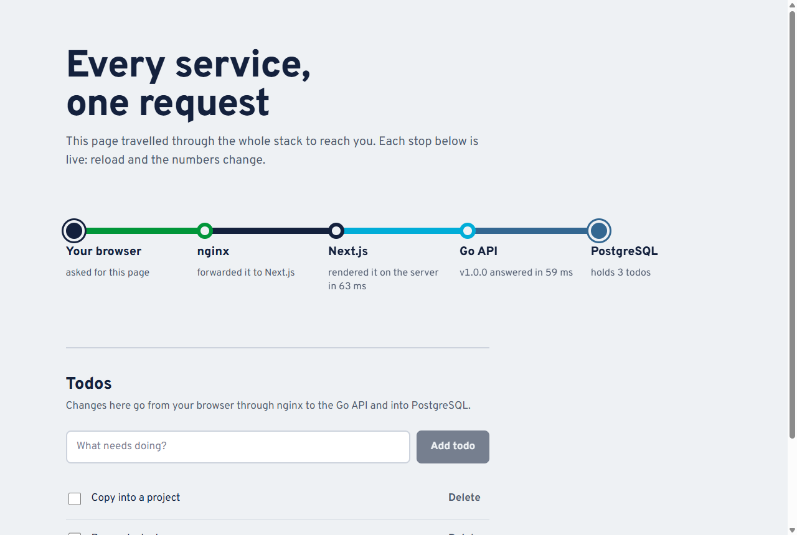

# Next.js + Go API + PostgreSQL behind nginx

A complete web stack with **one public entry point**. nginx routes `/api/*` to a Go API and everything else to a Next.js app, and PostgreSQL sits on an internal-only network. The demo page draws the request path as a transit line, with live data from each hop of the render that produced it.



## Quick start

```bash
cp .env.example .env      # set POSTGRES_PASSWORD
docker compose up -d --build --wait
make test                 # smoke test, entirely through nginx
```

Open http://localhost:8080.

## Architecture

```
                         ┌───────────── frontend network ─────────────┐
 browser ──► nginx :8080 ┤  /api/*  ──────────────► api :8080          │
 (127.0.0.1)             │  /*      ──► web :3000 ──► api :8080 (SSR)  │
                         └────────────────────────────────┬────────────┘
                                   backend network (internal: true)
                                     api, web, migrate ──► postgres :5432
```

- **One published port**: only nginx is reachable from the host. `web`, `api` and `postgres` have no `ports:`.
- **Two routes to the API**: the browser calls `/api/...` on nginx, same-origin, so there's no CORS to configure. During server-side rendering, Next.js calls `http://api:8080` directly on the internal network.
- **`backend` is `internal: true`**: containers on it have no route to the internet, and PostgreSQL is only on this network.
- Start order: `postgres` (healthy) → `migrate` (exits 0) → `api` (healthy) → `web` (healthy) → `nginx` (healthy).

## Services

| Service    | Image / build                                         | Exposed               | Size (uncompressed / pull) |
|------------|-------------------------------------------------------|-----------------------|----------------------------|
| `nginx`    | `nginxinc/nginx-unprivileged:1.31.6-alpine3.24`       | `127.0.0.1:8080`      | upstream image             |
| `web`      | `web/Dockerfile` (Next.js 16 standalone, Node 24)     | internal `:3000`      | **~188 MB / 75 MB**        |
| `api`      | `api/Dockerfile` (Go, distroless static)              | internal `:8080`      | **~13 MB / 5.2 MB**        |
| `migrate`  | `migrate/migrate:v4.20.1`                             | – (runs once)         | upstream image             |
| `postgres` | `postgres:16.15-alpine3.24`                           | internal `:5432`      | upstream image             |

Docker 29's `docker image ls` shows larger "disk usage" figures (298 MB and 22.6 MB), because its containerd store counts both the compressed and the unpacked copy.

**web image**: `output: 'standalone'` makes `next build` emit `server.js` plus only the `node_modules` files it actually imports. The runner stage copies that, `.next/static` and `public/`, removes npm/npx/corepack/yarn, keeps the files root-owned, and runs as `node`. The Node binary itself is 126 MB of the total.

**api image**: the same service as [`../go-api`](../go-api), copied into `api/` so this folder works on its own. It's a static, stripped binary on `distroless/static`, runs as user `65532`, and has a `healthcheck` subcommand because the image has no shell.

## nginx

[`nginx/nginx.conf`](nginx/nginx.conf):

- Security headers on every response: `X-Content-Type-Options`, `X-Frame-Options: DENY`, `Referrer-Policy`, `Permissions-Policy`. `server_tokens off` hides the version, and Next's `X-Powered-By` is off.
- `limit_req` at 20 requests/s per IP on `/api/` (burst 40), returning `429`.
- gzip, upstream keepalive, JSON access logs on stdout (ready for [`../logging`](../logging)).
- `resolver 127.0.0.11` + `server … resolve`: nginx re-resolves `web` and `api` through Docker's DNS. Without this, recreating a container (a redeploy) gives it a new IP and nginx answers 502 until restarted. The smoke test recreates `web` to check this.
- Runs unprivileged on port 8080, with a read-only root filesystem (temp paths in a `tmpfs`).

Every app container is `read_only`, with `cap_drop: [ALL]`, `no-new-privileges` and memory/CPU limits.

## API (through nginx)

| Method   | Path                  | Notes |
|----------|-----------------------|-------|
| `GET`    | `/api/health`         | `{"status":"ok","db":"ok","version":"1.0.0"}` |
| `GET`    | `/api/v1/todos`       | `?limit=1..100&offset=0` |
| `POST`   | `/api/v1/todos`       | `{"title":"...", "done":false}` → `201` |
| `GET`    | `/api/v1/todos/{id}`  | `200` / `404` |
| `PATCH`  | `/api/v1/todos/{id}`  | `{"title"?, "done"?}` |
| `DELETE` | `/api/v1/todos/{id}`  | `204` / `404` |

## Environment variables

| Variable            | Default      | Description |
|---------------------|--------------|-------------|
| `HTTP_PORT`         | `8080`       | Host port for nginx (the only published port) |
| `POSTGRES_USER`     | `app`        | Database owner, used by the API |
| `POSTGRES_PASSWORD` | **required** | URL-safe characters (goes into `DATABASE_URL`) |
| `POSTGRES_DB`       | `app`        | Database name |
| `API_VERSION`       | `1.0.0`      | Baked into the Go binary, shown on the page |
| `LOG_LEVEL`         | `info`       | API log level |

## Default credentials

PostgreSQL `app` / `change-me-postgres`. No app-level auth; add it in the API before exposing this stack.

## Connecting

- **Browser / host tools**: http://localhost:8080 (page) and http://localhost:8080/api/... (API).
- **Database**: `make psql`. To use a GUI client, add `ports: ["127.0.0.1:5432:5432"]` to `postgres`.
- **Exposing beyond localhost**: drop `127.0.0.1:` from nginx's port, and terminate TLS in front of it, for example with a Traefik or Caddy container, or a cloud load balancer.

## Developing

```bash
cd web && npm ci && API_INTERNAL_URL=http://localhost:8081 npm run dev   # Next.js dev server
make unit-test                                                          # go vet + go test for api/
```

For hot reload of the Go API, use [`../go-api`](../go-api)'s `dev` profile and point `API_INTERNAL_URL` at it.

## Reset data

```bash
make reset        # asks for confirmation, then: docker compose down -v
```

## Troubleshooting

| Symptom | Fix |
|---|---|
| The page says nginx was skipped | You opened the web container directly. Use the nginx port. |
| The page says the Go API didn't answer | `docker compose logs api migrate`. Usually a failed migration or a wrong `POSTGRES_PASSWORD`. |
| `502 Bad Gateway` | An upstream is down or still starting: `make ps`. nginx re-resolves names every 10 s. |
| `429 Too Many Requests` on `/api/` | Rate limit (20 r/s per IP). Tune `limit_req_zone` in `nginx.conf`. |
| `next build` fails fetching fonts | The build downloads Overpass from Google Fonts. It needs network at build time only. |
| Containers can't reach the internet from `backend` | Intended (`internal: true`). Put the service on `frontend` too if it needs outbound access. |

## Files

```
fullstack/
├── compose.yaml, .env.example
├── nginx/nginx.conf
├── web/                 # Next.js 16 app (App Router, standalone output)
│   ├── app/             # page.tsx (SSR), route-map.tsx, todos.tsx (client), healthz/
│   ├── lib/api.ts       # server-side API client
│   └── Dockerfile, .dockerignore, package.json, package-lock.json, next.config.ts
├── api/                 # Go API (copy of ../go-api without the dev stage)
├── docs/screenshot.png
├── Makefile             # up, down, logs, ps, reset, test, unit-test, psql
└── smoke-test.sh
```
