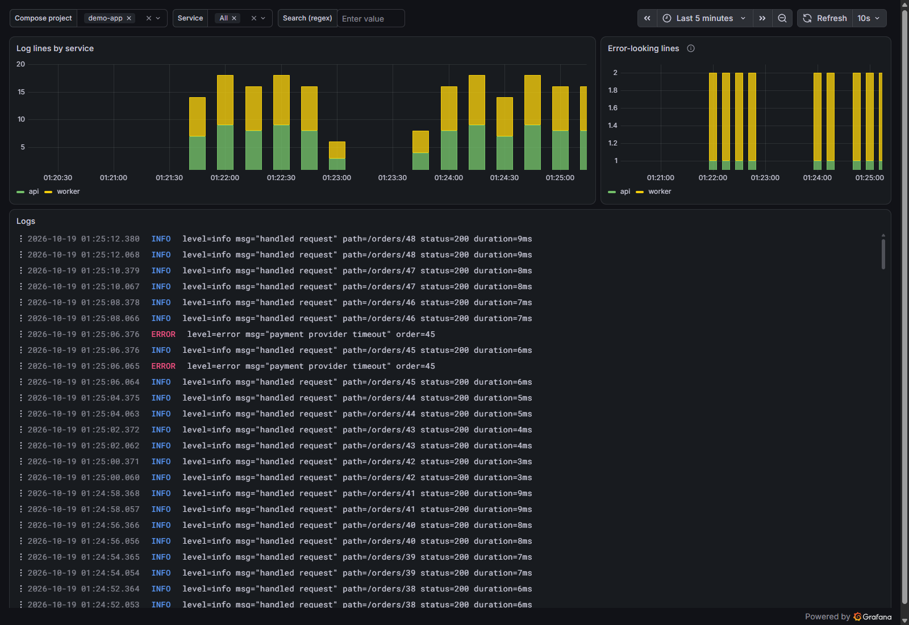

# Loki + Grafana Alloy + Grafana

Centralised logs for **every container on the Docker host**. Grafana Alloy discovers containers through the Docker API and ships their stdout/stderr to Loki, labelled with the compose project and service. Grafana starts with the Loki datasource and a **Container Logs** dashboard.



> **Why Alloy and not Promtail?** Promtail is deprecated, and its support ended on 2 March 2026. Grafana Alloy is its official replacement and handles the same job with one config file ([`alloy/config.alloy`](alloy/config.alloy)).

## Quick start

```bash
cp .env.example .env      # set GRAFANA_ADMIN_PASSWORD
docker compose up -d --build --wait
make test                 # smoke test: a probe container's log line reaches Loki
```

Open http://localhost:3000. The dashboard is the home page, and **Explore** has free-form LogQL.

## Services

| Service   | Image                                 | Host port               | Notes                                   |
|-----------|---------------------------------------|-------------------------|-----------------------------------------|
| `loki`    | built from `grafana/loki:3.7.8`       | `127.0.0.1:3100`        | single binary, filesystem storage, 7-day retention |
| `alloy`   | `grafana/alloy:v1.20.1`               | `127.0.0.1:12345` (UI)  | Docker discovery + log tailing          |
| `grafana` | `grafana/grafana:13.2.4`              | `127.0.0.1:3000`        | provisioned datasource + dashboard      |

**Why Loki is built locally:** the upstream image is distroless, with no shell and no `wget`, so a Docker healthcheck has nothing to run. [`loki/Dockerfile`](loki/Dockerfile) copies one static busybox binary into the official image, and the healthcheck uses only its `wget`. The image is about 1 MB larger than upstream, and Dependabot still updates the `FROM` line.

## Environment variables

| Variable                 | Default      | Description                               |
|--------------------------|--------------|-------------------------------------------|
| `GRAFANA_ADMIN_USER`     | `admin`      | Grafana admin user                        |
| `GRAFANA_ADMIN_PASSWORD` | **required** | Grafana admin password (first start only) |
| `GRAFANA_PORT`           | `3000`       | Grafana host port                         |
| `LOKI_PORT`              | `3100`       | Loki API host port                        |
| `ALLOY_PORT`             | `12345`      | Alloy debug UI host port                  |

Retention is `limits_config.retention_period` in [`loki/config.yaml`](loki/config.yaml) (default `168h`).

## Default credentials

Grafana: `admin` / `change-me-grafana`. Loki and Alloy have no auth; both are bound to `127.0.0.1`.

## Labels

| Label             | From                                      | Example          |
|-------------------|-------------------------------------------|------------------|
| `container`       | container name                            | `shop-api-1`     |
| `compose_project` | `com.docker.compose.project` label        | `shop`           |
| `compose_service` | `com.docker.compose.service` label        | `api`            |
| `stream`          | stdout / stderr                           | `stderr`         |

Example queries in Explore:

```logql
{compose_project="shop", compose_service="api"} |= "ERROR"
sum by (compose_service) (count_over_time({compose_project="shop"} [5m]))
{container=~".+"} | logfmt | level="error"
```

Every query needs at least one matcher that can't match an empty value. `{container=~".+"}` means "all logs".

**Opting a container out**: give it the label `logging=disabled`:

```yaml
services:
  noisy:
    labels:
      logging: disabled
```

## Connecting

- **Your other stacks**: nothing to do. Alloy reads every container on the host via the Docker socket.
- **Push from an app directly**: `POST http://localhost:3100/loki/api/v1/push` from the host, or `http://loki:3100` from the `logging_logging` network.
- **Query from the CLI**: `logcli --addr=http://localhost:3100 query '{compose_service="api"}'`.

## Reset data

```bash
make reset        # asks for confirmation, then: docker compose down -v
```

## Security note

Alloy mounts `/var/run/docker.sock`. Access to the Docker socket is equivalent to root on the host, and `:ro` doesn't change that: it only stops the socket file itself from being replaced. That's fine on a dev machine. On a shared server, put a Docker socket proxy in front, or read `/var/lib/docker/containers/*/*.log` files instead.

## Troubleshooting

| Symptom | Fix |
|---|---|
| `queries require at least one regexp or equality matcher that does not have an empty-compatible value` | Add a matcher like `container=~".+"` (see above). |
| A container's logs are missing | Check Alloy's UI at http://localhost:12345 (component `loki.source.docker.containers`). Does the container have `logging=disabled`? |
| Logs from very short-lived containers are missing | Discovery refreshes every 5 s. Containers that exit sooner may be missed. Lower `refresh_interval` in `config.alloy`. |
| `entry too far behind` / `too old` | Loki rejects samples older than 7 days (`reject_old_samples_max_age`). |
| Loki `unhealthy` for the first ~15 s | Normal: the ingester joins its ring before `/ready` returns 200. |

## Files

```
logging/
├── compose.yaml
├── .env.example
├── loki/Dockerfile, loki/config.yaml
├── alloy/config.alloy
├── grafana/provisioning/ + grafana/dashboards/container-logs.json
├── docs/logs-dashboard.png
├── Makefile               # up, down, logs, ps, reset, test
└── smoke-test.sh
```
