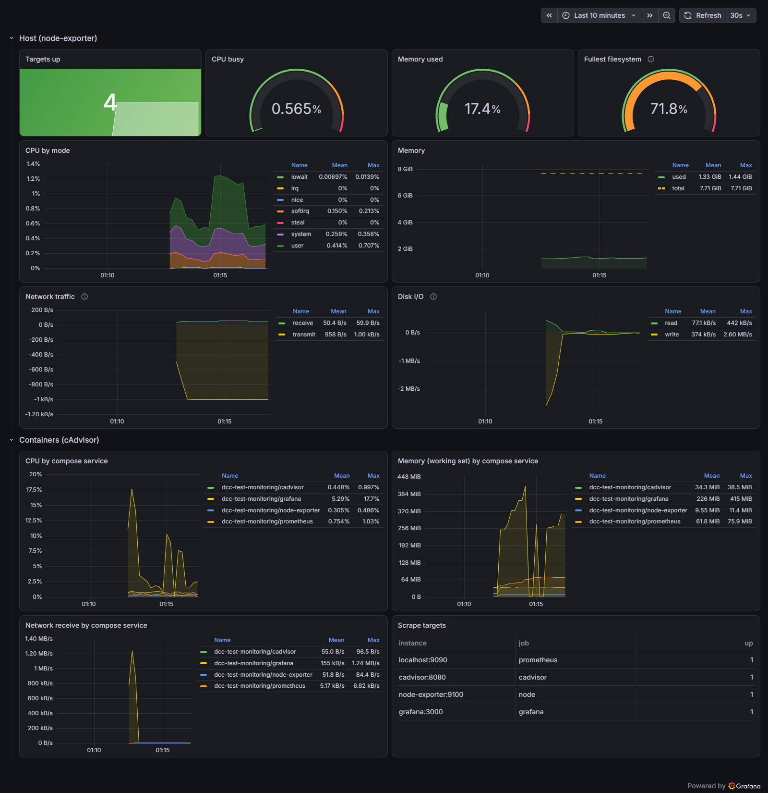

# Prometheus + Grafana + node-exporter + cAdvisor

A complete metrics stack. Prometheus scrapes host metrics (node-exporter) and per-container metrics (cAdvisor), and Grafana starts with the Prometheus datasource and a **Host & Containers** dashboard already provisioned. Example alert rules are included.



## Quick start

```bash
cp .env.example .env      # set GRAFANA_ADMIN_PASSWORD
docker compose up -d --wait
make test                 # smoke test: targets up, datasource healthy, dashboard present
```

Open http://localhost:3000, log in as `admin`, and the dashboard is the home page.

## Services

| Service         | Image                             | Host port              | Notes                                   |
|-----------------|-----------------------------------|------------------------|-----------------------------------------|
| `prometheus`    | `prom/prometheus:v3.15.0`         | `127.0.0.1:9090`       | 15 s scrape interval, `--web.enable-lifecycle` |
| `grafana`       | `grafana/grafana:13.2.4`          | `127.0.0.1:3000`       | provisioned datasource and dashboard    |
| `node-exporter` | `prom/node-exporter:v1.12.1`      | – (internal `:9100`)   | host CPU, memory, disk, network         |
| `cadvisor`      | `ghcr.io/google/cadvisor:v0.60.6` | – (internal `:8080`)   | per-container metrics, privileged       |

node-exporter and cAdvisor are deliberately **not** published on the host. Only Prometheus reads them, over the compose network.

## Environment variables

| Variable                 | Default      | Description                                  |
|--------------------------|--------------|----------------------------------------------|
| `GRAFANA_ADMIN_USER`     | `admin`      | Grafana admin user                           |
| `GRAFANA_ADMIN_PASSWORD` | **required** | Grafana admin password (first start only)    |
| `GRAFANA_PORT`           | `3000`       | Grafana host port                            |
| `PROMETHEUS_PORT`        | `9090`       | Prometheus host port                         |
| `PROMETHEUS_RETENTION`   | `15d`        | How long samples are kept                    |

## Default credentials

Grafana: `admin` / `change-me-grafana`. Prometheus has no login; it's bound to `127.0.0.1`.

## What's provisioned

```
prometheus/prometheus.yml                      # scrape jobs: prometheus, node, cadvisor, grafana
prometheus/rules/alerts.yml                    # TargetDown, HostHighCpu, HostLowDiskSpace
grafana/provisioning/datasources/prometheus.yml  # datasource uid "prometheus"
grafana/provisioning/dashboards/dashboards.yml   # loads everything in grafana/dashboards/
grafana/dashboards/host-and-containers.json      # the dashboard
```

To add a dashboard, drop its JSON into `grafana/dashboards/` (with `"uid"` set and the datasource uid `prometheus`). Grafana picks it up within a minute. Provisioned dashboards are read-only in the UI: edit the file, or *Save as* a copy.

## Monitoring your own app

Put the app on this stack's network and add a scrape job:

```yaml
# prometheus/prometheus.yml
  - job_name: my-app
    static_configs:
      - targets: ["my-app:8080"]     # serves /metrics
```

```bash
make reload        # re-reads prometheus.yml and rules, no restart
```

The app joins the network like this (network `monitoring_monitoring`, i.e. `<project>_monitoring`):

```yaml
services:
  my-app:
    networks: [monitoring_monitoring]
networks:
  monitoring_monitoring:
    external: true
```

## Connecting

- **From the host**: Grafana at http://localhost:3000, Prometheus UI and API at http://localhost:9090 (e.g. `curl 'localhost:9090/api/v1/query?query=up'`).
- **From another container on the network**: `http://prometheus:9090`, `http://grafana:3000`.

## Reset data

```bash
make reset        # asks for confirmation, then: docker compose down -v
```

This deletes the stored metrics and Grafana's database (users, any dashboards you saved in the UI). Provisioned files are untouched.

## Docker Desktop vs Linux

On Docker Desktop (macOS and Windows), the "host" that node-exporter and cAdvisor see is the **Linux VM Docker runs in**, not your Mac or PC. The numbers are real, just for the VM. On a Linux server they describe the machine itself. There, consider mounting the root filesystem with `rslave` (see the comment in `compose.yaml`; Docker Desktop rejects it).

## Troubleshooting

| Symptom | Fix |
|---|---|
| `path / is mounted on / but it is not a shared or slave mount` | You added `rslave` on Docker Desktop. Remove it there. |
| A target shows `DOWN` at http://localhost:9090/targets | Is the service on the `monitoring` network, and does `/metrics` answer on that port? |
| Container panels are empty | cAdvisor needs `privileged`, the `/var/lib/docker` + `/sys` mounts, and both the Docker and containerd sockets. `docker compose logs cadvisor` shows `Registration of the docker container factory failed` when a socket is missing. On rootless or Podman setups, paths differ. |
| Grafana login fails after changing `.env` | The admin password is set on first start only. Run `docker compose exec grafana grafana cli admin reset-admin-password <new>`. |
| Dashboard edits are lost | Provisioned dashboards are read-only. Edit `grafana/dashboards/*.json`. |

## Files

```
monitoring/
├── compose.yaml
├── .env.example
├── prometheus/            # prometheus.yml + rules/
├── grafana/               # provisioning/ + dashboards/
├── docs/dashboard.png
├── Makefile               # up, down, logs, ps, reset, test, reload
└── smoke-test.sh
```
